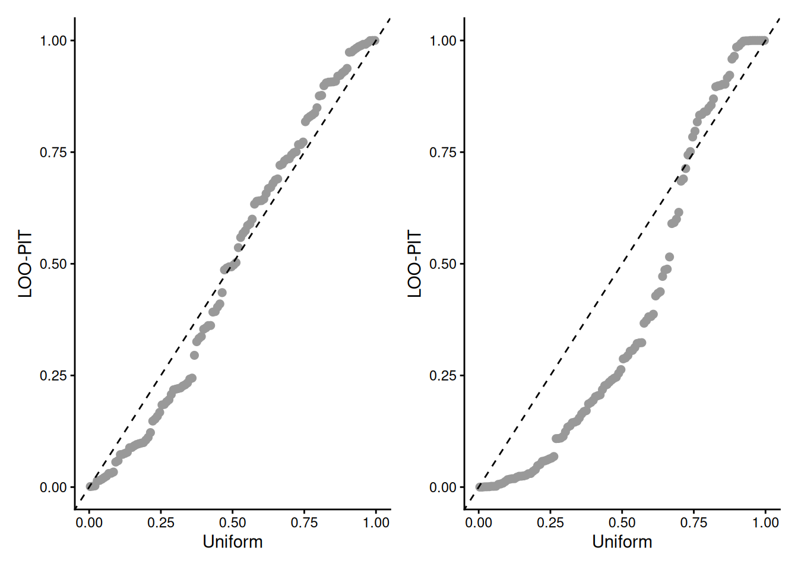
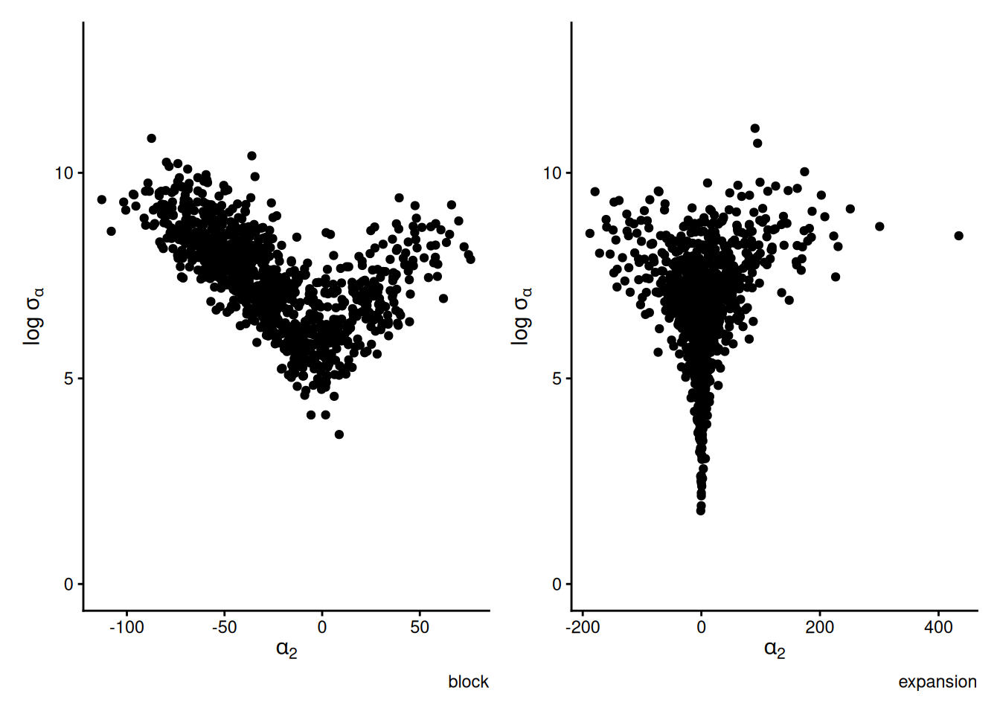
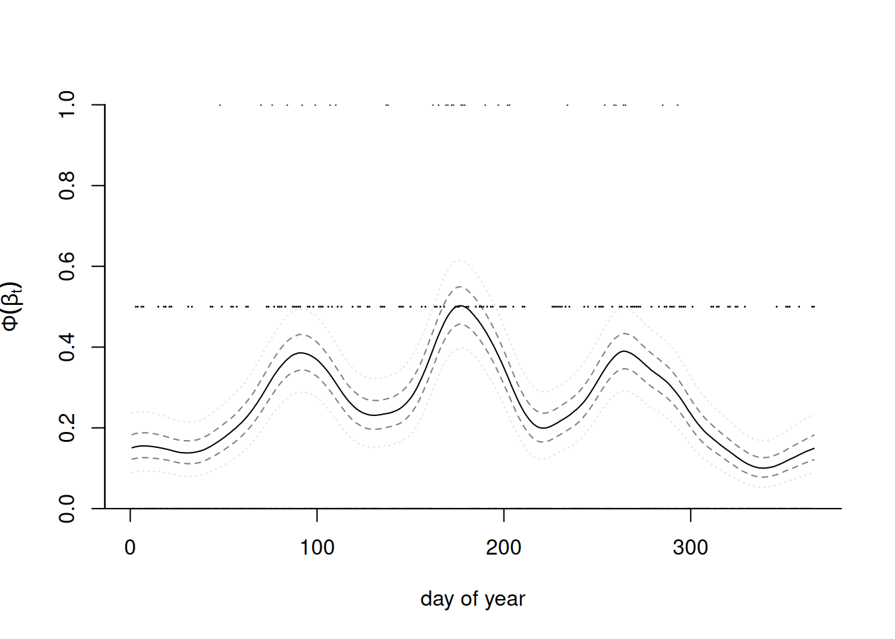
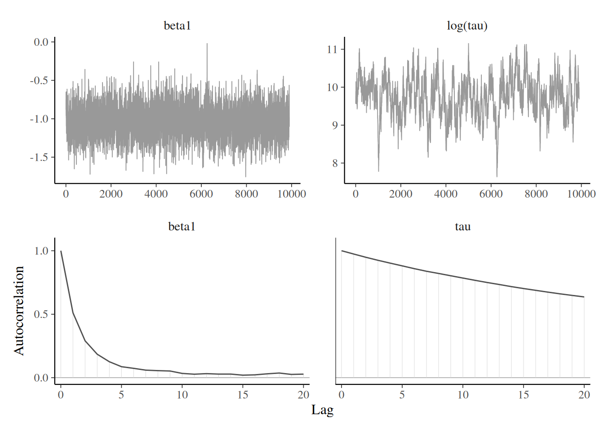
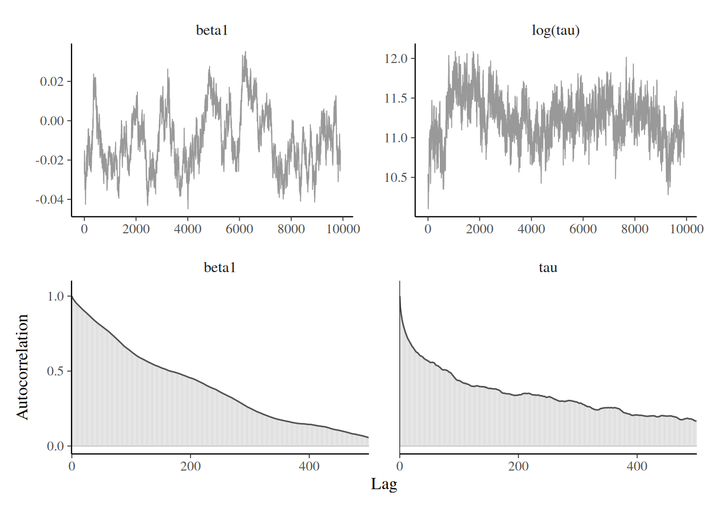
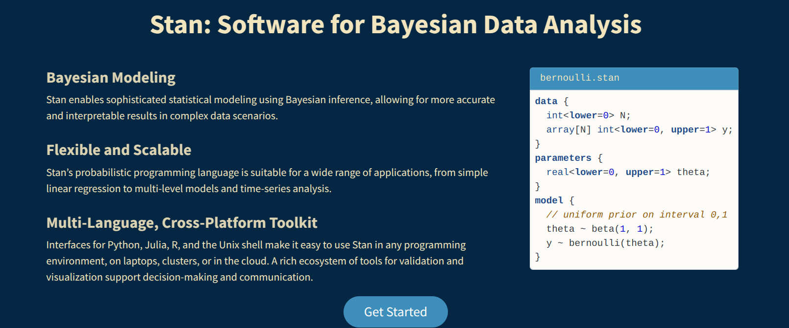

```{r}
#| include: false
#| eval: true
#| echo: false
hecbleu <- c("#002855")
fcols <- c(gris = "#888b8d",
           bleu = "#0072ce",
           aqua = "#00aec7",
           vert = "#26d07c",
           rouge = "#ff585d",
           rose = "#eb6fbd",
           jaune = "#f3d03e")
pcols <- c(gris = "#d9d9d6",
           bleu = "#92c1e9",
           agua = "#88dbdf",
           vert = "#8fe2b0",
           rouge = "#ffb1bb",
           rose = "#eab8e4",
           jaune = "#f2f0a1")
library(ggplot2)
theme_set(theme_classic())
library(patchwork)
knitr::opts_chunk$set(fig.retina = 3, collapse = TRUE)
options(digits = 3, width = 75)
```

## Measuring model adequacy


Consider estimation of the leave-one predictive density under the hypothesis that the likelihood factorizes as $$L(\boldsymbol{\theta}; \boldsymbol{y}) = \prod_{i=1}^n f_i(y_i; \boldsymbol{\theta});$$ where $f_i$ is the density or mass function of the $i$th observation.


Observations are then exchangeable.


## Leave-one-out cross validation

We can measure the predictive performance using the leave-one-out predictive distribution for observation $i$ given all the rest of the observations $\boldsymbol{y}_{-i}$, $$p(y_i \mid \boldsymbol{y}_{-i}) = \int f_i(y_i \mid \boldsymbol{\theta}) p(\boldsymbol{\theta} \mid \boldsymbol{y}_{-i}) \mathrm{d} \boldsymbol{\theta}.$$

Naively, this requires running $n$ Markov chains with $n-1$ observations each.


## Leave-one-out cross-validation (LOO-CV)

With weights
$w_i(\boldsymbol{\theta}) = {p(\boldsymbol{\theta} \mid \boldsymbol{y}_{-i})}/{p(\boldsymbol{\theta} \mid \boldsymbol{y})} \stackrel{\boldsymbol{\theta}}{\propto}1/f_i(y_i; \boldsymbol{\theta})$
we can write the leave-one-out posterior predictive as
\begin{align*}
p(y_i \mid \boldsymbol{y}_{-i}) &= \int_{\boldsymbol{\Theta}} f_i(y_i; \boldsymbol{\theta}) p(\boldsymbol{\theta} \mid \boldsymbol{y}_{-i}) \mathrm{d} \boldsymbol{\theta}
\\& = \int_{\boldsymbol{\Theta}} f_i(y_i; \boldsymbol{\theta}) w_i(\boldsymbol{\theta}) p(\boldsymbol{\theta} \mid \boldsymbol{y}) \mathrm{d} \boldsymbol{\theta}.
\end{align*}

## Importance sampling for LOO-CV {.smaller}


This formula suggests the importance sampling estimator (eq. 25 of Section 7 of @Gelfand.Dey:1994)
\begin{align*}
\widehat{p}(y_i \mid \boldsymbol{y}_{-i}) &= \frac{\sum_{b=1}^B f_i(y_i; \boldsymbol{\theta}_b) w_i(\boldsymbol{\theta}_b)}{\sum_{b=1}^Bw_i(\boldsymbol{\theta}_b)}  
\\&= B \left\{\sum_{b=1}^B \frac{1}{f_i (y_i; \boldsymbol{\theta}_b)}\right\}^{-1}.
\end{align*}


::: {style="font-size: 0.9em;"}
This estimator takes the form of an harmonic mean, which can have very large variance due to some weights dominating the fit. @Vehtari.Gelman.Gabry:2017 proposed using Pareto smoothed importance sampling [@Vehtari.Simpson.Gelman.Yao.Gabry:2025] to avoid overly large weights; this method is implemented in the `loo` **R** package.

:::

## Marginal predictive check


For each posterior draw and each observation, we 

- generate a sample from the posterior predictive, resulting in an $n \times B$ matrix. 
- Each observation $y_i$ is compared with the simulated samples $y_{i,b}^{\mathrm{rep}}$ for posterior  $\boldsymbol{\theta}_b.$ 
- We compute $\Pr(y_i \geq y_{i}^{\mathrm{rep}})$ by Monte Carlo, by looking at the sample proportion that are more extreme.  

Values close to zero or one may indicate outliers.


## Marginal predictive check with LOO-CV

Suppose we have an $n \times B$ matrix with the posterior predictive draws $y_{i,b}^{\mathrm{rep}}$ associated with each posterior vector $\boldsymbol{\theta}_b$ and the weights $w_{i,b} = 1/f_i (y_i \mid \boldsymbol{\theta}_b).$ 

We can then compute the probability integral transform with importance sampling for $i =1,\ldots, n$:
\begin{align*}
\widehat{p}_i^{\mathrm{loo}} = \Pr(y_i^{\mathrm{rep}} \leq y_i \mid \boldsymbol{y}_{-i}) \approx \frac{\sum_{b=1}^B \mathrm{I}(y_i^{\mathrm{rep}} \leq y_i)w_{i,b}}{\sum_{b=1}^B w_{i,b}}
\end{align*}

## Probability-probability plots {.smaller}

The values  $\widehat{p}_i^{\mathrm{loo}}$ should be  approximately uniform if the model was perfectly calibrated. We build a P-P plot (ordered values against uniform plotting position) to check this.

```{r}
#| eval: true
#| echo: false
#| out-width: '60%'
#| fig-align: 'center'

```

## Sources of poor mixing

Slow mixing can be due to the following:

- poor proposals
- strong correlation between posterior parameters
- overparametrization and lack of identifiability


## Computational strategies

These problems can be addressed using one of the following:

- marginalization
- removing redundant parameters or using informative priors
- reparametrization
- clever proposals (adaptive MCMC) see @Andrieu.Thoms:2008 and @Rosenthal:2011
- blocking

## One-way ANOVA

Consider a one-way ANOVA with $n$ observations from $K$ categories, with observation $i=1, \ldots, n_k$ from group $k$ having contribution
\begin{align*}
Y_{i,k} &\sim \mathsf{Gauss}(\mu + \alpha_k, \sigma^2_y), \\
\alpha_k &\sim \mathsf{Gauss}(0, \sigma^2_\alpha).
\end{align*}
We set an improper prior for the mean $p(\mu) \propto 1.$

If there are $K$ groups, then the group-specific mean is $\mu+\alpha_k$, and there is a redundant parameter. This leads to poor mixing if priors are not informative.


## Removing redundant parameters

We can enforce a sum-to-zero constraint for $\sum_{k=1}^K \alpha_k=0$ and sample $K-1$ parameters for the difference to the global mean.

This yields a degenerate multivariate Gaussian distribution for the vector $\boldsymbol{\alpha} \sim \mathsf{Gauss}_K(\boldsymbol{0}_K, \boldsymbol{\Omega})$ where
$$\boldsymbol{\Omega} =\sigma^2_\alpha \left(\mathbf{I}_K - \boldsymbol{1}_K\boldsymbol{1}_K^\top / K\right).$$

## Marginalization

Given a model $p(\boldsymbol{\theta}, \boldsymbol{Z})$, reduce the dependance by sampling from the marginal

$$
p(\boldsymbol{\theta})= \int p(\boldsymbol{\theta}, \boldsymbol{z}) \mathrm{d} \boldsymbol{z}.
$$

This reduces dependency between parameters, but typically the likelihood becomes more expensive to compute

## Marginalization in one-way ANOVA

<!-- We can marginalize over the $K$ vector of $\boldsymbol{\alpha}$ to perform updates of the global mean $\mu \mid \sigma^2_y, \sigma^2_\alpha, \boldsymbol{y}:$  this yields $$\boldsymbol{Y} \mid \mu, \sigma^2_y, \sigma^2_\alpha \sim \mathsf{Gauss}_n\left(\mu\boldsymbol{1}_n, \boldsymbol{\varSigma}\right),$$  -->
where $\boldsymbol{\varSigma} = g(\sigma^2_y, \sigma^2_\alpha)$ is the marginal covariance matrix.

## Marginalization for one-way ANOVA

Straightforward calculations then yield

$$\mu \mid \sigma^2_y, \sigma^2_\alpha, \boldsymbol{y} \sim \mathsf{Gauss}\left(\frac{\boldsymbol{y}^\top \boldsymbol{\varSigma}^{-1}\boldsymbol{1}_n}{\boldsymbol{1}_n^\top\boldsymbol{\varSigma}^{-1}\boldsymbol{1}_n}, \left\{\boldsymbol{1}_n^\top\boldsymbol{\varSigma}^{-1}\boldsymbol{1}_n\right\}^{-1}\right).
$$

## Gaussian model with random effects


Consider a hierarchical Gaussian model of the form
\begin{align*}
\boldsymbol{Y} = \mathbf{X}\boldsymbol{\beta} + \mathbf{Z}\boldsymbol{B} + \boldsymbol{\varepsilon}
\end{align*}
where

- $\mathbf{X}$ is an $n \times p$ design matrix with centered inputs,
- $\boldsymbol{\beta} \sim \mathsf{Gauss}(\boldsymbol{0}_p, \sigma^2\mathbf{I}_p),$
- $\boldsymbol{B}\sim \mathsf{Gauss}_q(\boldsymbol{0}_q, \boldsymbol{\Omega})$ are random effects and
- $\boldsymbol{\varepsilon} \sim \mathsf{Gauss}_n(\boldsymbol{0}_n, \kappa^2\mathbf{I}_n)$ are independent white noise.


## Marginalization of Gaussian models

We can write
\begin{align*}
\boldsymbol{Y} \mid \boldsymbol{\beta}, \boldsymbol{B}, \kappa^2 &\sim \mathsf{Gauss}_n(\mathbf{X}\boldsymbol{\beta} + \mathbf{Z}\boldsymbol{B}, \kappa^2\mathbf{I}_n)\\
\boldsymbol{Y} \mid \boldsymbol{\beta} &\sim \mathsf{Gauss}_n(\mathbf{X}\boldsymbol{\beta}, \mathbf{Q}^{-1}),
\end{align*}
where the second line is obtained by marginalizing out the random effects $\boldsymbol{B}.$

## Efficient calculations for Gaussian models

If, as is often the case, $\boldsymbol{\Omega}^{-1}$ and $\mathbf{Z}$ are sparse matrices, the full precision matrix can be efficiently computed using Shermann--Morisson--Woodbury identity as
\begin{align*}
\mathbf{Q}^{-1} &=   \mathbf{Z}\boldsymbol{\Omega}^{-1}\mathbf{Z}^\top + \kappa^2 \mathbf{I}_n,\\
\kappa^2\mathbf{Q} & = \mathbf{I}_n - \mathbf{Z} \boldsymbol{G}^{-1} \mathbf{Z}^\top,\\
\boldsymbol{G} &= \mathbf{Z}^\top\mathbf{Z} + \kappa^2 \boldsymbol{\Omega}^{-1}
\end{align*}
Section 3.1 of @Nychka:2015 details efficient ways of calculating the quadratic form involving $\mathbf{Q}$ and it's determinant.


## Parameter expansion

An alternative to data augmentation, parameter expansion adds redundant parameter to improve mixing  [@Liu.Rubin.Wu:1998,@Gelman.vanDyk:2008]

Consider the one-way ANOVA model where we write $\alpha_k = \nu\xi_k$ and $\sigma_\alpha = |\nu|\sigma_\xi$, with
\begin{align*}
Y_{i,k} &\sim \mathsf{Gauss}(\mu + \nu\xi_k, \sigma^2_y) \\
\xi_k &\sim \mathsf{Gauss}(0, \sigma^2_\xi) \\
p(\nu) &\propto 1.
\end{align*}

## Eight school example

Consider the eight school data from Educational Testing Service (ETS) [@Gelman:2013]. The goal of the experiment was to estimate the effect of coaching on SAT-V scores.

The data consist of estimated treatment mean difference $y_1, \ldots, y_8$ and their standard errors $s_1, \ldots, s_8$ from eight different schools.


Simple sample sizes are large, the average treatment effect (ATE) can be considered approximately Gaussian. We treat the school-specific standard errors $s_j$ as a known quantity.

## Gibbs sampler for eight school problem {.smaller}

The naive Gibbs sampler, which iterates between conditionals of $p(\boldsymbol{\alpha} \mid \boldsymbol{y}, \boldsymbol{s}^2, \mu, \sigma^2_{\alpha})$ and $p(\mu \mid \boldsymbol{y}, \boldsymbol{s}^2, \boldsymbol{\alpha})$ leads to strong autocorrelation. 

A better strategy is to marginalize over the global mean $\mu$ and simulate from $p(\boldsymbol{\alpha} \mid \boldsymbol{y}, \boldsymbol{s}^2, \sigma^2_{\alpha})$ instead. We get then the conditionals
\begin{align*}
\alpha_i \mid y_i, s_i^2, \sigma^2_{\alpha} &\sim \mathsf{Gauss}\left\{\frac{y_is^{-2}_i}{s^{-2}_i + \sigma^{-2}_{\alpha}}, \left(s^{-2}_i + \sigma^{-2}_{\alpha}\right)^{-1}\right\}\\
\mu \mid \boldsymbol{y}, \boldsymbol{s}^2, \boldsymbol{\alpha} & \sim \mathsf{Gauss}\left( s^2_{\mu} \sum_{j=1}^8 \frac{y_j-\alpha_j}{s^2_j}, s^2_{\mu}\right)\\
\sigma^2_{\alpha} \mid \boldsymbol{\alpha} &\sim \mathsf{inv. gamma}\left( \frac{n-1}{2}, \frac{\sum_{j=1}^8 \alpha_j^2}{2}\right)
\end{align*}
where $s^{-2}_{\mu} =\sum_{j=1}^8 s_j^{-2}.$

## Parameter expansion for the eight school problem {.smaller}

The parameter expansion sampler proceeds in exactly the same way with the same conditionals for $\sigma_{\xi}^2$ and $\boldsymbol{\xi}$ as above; the only additional step is 
\begin{align*}
\nu \mid \boldsymbol{y}, \boldsymbol{s}^2, \boldsymbol{\xi} & \sim \mathsf{Gauss}\left\{ \left( \sum_{j=1}^8 \frac{\xi_j^2}{s_j^2}\right)^{-1} \sum_{j=1}^8 \frac{\xi_j(y_j-\mu)}{s^2_j}, \left( \sum_{j=1}^8 \frac{\xi_j^2}{s_j^2}\right)^{-1}\right\}.
\end{align*}

After each update, we then save  $\alpha_j = \nu \xi_j$ and $\sigma_\alpha = |\nu|\sigma_\xi,$ as the other parameters are not identifiable. 


## Funnel geometry 

```{r}
#| eval: true
#| echo: false
#| out-width: '80%'
#| fig-align: 'center'

```

## Blocking

Identify groups of strongly correlated parameters and propose a joint update for these.

- The more parameters we propose at the same time, the lower the chance of acceptance,
- Often ways to sample these efficiently.


## Tokyo rainfall

We consider data from @Kitagawa:1987 that provide a binomial time series giving the number of days in years 1983 and 1984 (a leap year) in which there was more than 1mm of rain in Tokyo; see section 4.3.4 of @Rue.Held:2005.


We have 

- $T=366$ days and 
- $n_t \in \{1,2\}$ $(t=1, \ldots, T)$observations in day $t$ and 
- $y_t=\{0,\ldots, n_t\}$ the number of days with rain.


## Smoothing probabilities

The objective is to obtain a smoothed probability of rain. The underlying probit model considered takes $$Y_t \mid n_t, p_t \sim \mathsf{binom}(n_t, p_t), \qquad p_t = \Phi(\beta_t).$$


We specify the random effects $\boldsymbol{\beta} \sim \mathsf{Gauss}_{T}(\boldsymbol{0}, \tau^{-1}\mathbf{Q}^{-1}),$ where $\mathbf{Q}$ is a $T \times T$ precision matrix that encodes the local dependence.


## Random walk prior

::: {style="font-size: 0.8em;"}
A circular random walk structure of order 2 is used to model the smooth curves by smoothing over neighbors, and enforces small second derivative. This is a suitable prior because it enforces no constraint on the mean structure. 

This amounts to specifying the process with for $t \in \mathbb{N} \mod 366 + 1$
:::


\begin{align*}
\Delta^2\beta_t &= (\beta_{t+1} - \beta_t) - (\beta_t - \beta_{t-1})
\\&=-\beta_{t-1} +2 \beta_t - \beta_{t+1} \sim \mathsf{Gauss}(0, \tau^{-1}).
\end{align*}

## Circulant precision matrix {.smaller}

This yields an intrinsic Gaussian Markov random field with a circulant precision matrix $\tau\mathbf{Q}$ of rank $T-1,$ where
\begin{align*}
\mathbf{Q} &=
\begin{pmatrix}
6 & -4 & 1 & 0 & \cdots & 1 & -4\\
-4 & 6 & -4 & 1 & \ddots & 0 & 1 \\
1 & -4 & 6 & -4 & \ddots & 0 & 0 \\
\vdots & \ddots & \ddots  & \ddots  & \ddots  & \ddots & \vdots \\
-4 & 1 & 0 & 0 & \cdots & -4 & 6
\end{pmatrix}.
\end{align*}
Because of the linear dependency, the determinant of $\mathbf{Q}$ is zero.


## Prior draws


```{r}
#| eval: true
#| echo: false
#| fig-cap: "Five realizations from the cyclical random walk Gaussian prior of order 2."
#| label: fig-CRW2-prior
nt <- 366
Q <- hecbayes::crw_Q(d = 366, type = "rw2", sparse = TRUE)
set.seed(1234)
samps <- solve(Matrix::chol(Q), matrix(rnorm(5*366), ncol = 5))
matplot(scale(samps, scale = FALSE),
        bty = "l",
        ylab = "",
 xlab = "day of year",
type = "l",
col = RColorBrewer::brewer.pal(n = 5, name = "Blues"),lwd = seq(2, 1, length.out = 5))

```

## Gibbs sampling for Tokyo data


We can perform data augmentation by imputing Gaussian variables, say $\{z_{t,i}\}$ from truncated Gaussian, where $z_{t,i} = \beta_t + \varepsilon_{t,i}$ and $\varepsilon_{t,i} \sim \mathsf{Gauss}(0,1)$ are independent standard Gaussian and
\begin{align*}
z_{t,i} \mid  y_{t,i}, \beta_t \sim
\begin{cases}
\mathsf{trunc. Gauss}(\beta_t, 1, -\infty, 0) & y_{t,i} = 0 \\
\mathsf{trunc. Gauss}(\beta_t, 1,  0, \infty) & y_{t,i} =1
\end{cases}
\end{align*}

## Posterior for Tokyo data

The posterior is proportional to
\begin{align*}
p(\boldsymbol{\beta} \mid \tau)p(\tau)\prod_{t=1}^{T}\prod_{i=1}^{n_t}p(y_{t,i} \mid z_{t,i}) p(z_{t,i} \mid \beta_t)
\end{align*}

## Data augmentation for Tokyo data

Once we have imputed the Gaussian latent vectors, we can work directly with the values of $z_t = \sum_{i=1}^{n_t} z_{i,t}$ 
\begin{align*}
p(\boldsymbol{\beta}, \tau) &\propto \tau^{(T-1)/2}\exp \left( - \frac{\tau}{2} \boldsymbol{\beta}^\top \mathbf{Q} \boldsymbol{\beta}\right)
\\& \times \exp\left\{ - \frac{1}{2} (\boldsymbol{z}/\boldsymbol{n} - \boldsymbol{\beta})^\top \mathrm{diag}(\boldsymbol{n})(\boldsymbol{z}/\boldsymbol{n} - \boldsymbol{\beta})\right\}
\\& \times \tau^{a-1}\exp(-\tau b)
\end{align*}
where $\boldsymbol{z} = (z_1, \ldots, z_T),$ as $n_t^{-1} z_t \sim \mathsf{Gauss}(\beta_t, n_t^{-1}).$

## Gibbs for Tokyo data - conditionals

Completing the quadratic form shows that
\begin{align*}
\boldsymbol{\beta} \mid \boldsymbol{z}, \tau &\sim \mathsf{Gauss}_T\left(\mathbf{Q}^{\star -1} \boldsymbol{z}, \mathbf{Q}^{\star -1}\right)\\
\tau \mid \boldsymbol{\beta} & \sim \mathsf{gamma}\left( \frac{T-1}{2} + a, \frac{\boldsymbol{\beta}^\top \mathbf{Q}\boldsymbol{\beta}}{2} + b \right),\\
\mathbf{Q}^{\star} &= \left\{\tau \mathbf{Q} + \mathrm{diag}(\boldsymbol{n})\right\}
\end{align*}

## Posterior prediction for probability of rainfall





## Blocking vs joint update

Compare the following two stategies

- joint update: given $\boldsymbol{z}$ and $\tau$, simulate $\boldsymbol{\beta}$ jointly
- one-parameter at a time: starting from $i \sim \mathsf{unif}(\{1, \ldots, 366\}),$ get index $t= i \mod 366 + 1$ and simulate $\beta_i \mid \boldsymbol{\beta}_{-i}, \boldsymbol{z}, \tau$ one at a time.

## Blocking strategy



## Individual update strategy




## Lessons from the Tokyo example


What happened?

- there is lower autocorrelation with the joint update (also faster here!) for the $\boldsymbol{\beta}$
- in both cases, $\tau \mid \cdot$ mixes poorly because the values of $\boldsymbol{\beta}$ were sampled conditional on the previous value.

A better avenue would be to use a Metropolis random walk for $\tau^{\star}$, simulate $\boldsymbol{\beta} \mid \tau^{\star}$ and propose the joint vector $(\tau^{\star}, \boldsymbol{\beta}^{\star})$ simultaneously.

## One step further

We could also remove the data augmentation step and propose from a Gaussian approximation of the log likelihood, using
a Taylor series expansion of the log likelihood about $\boldsymbol{\beta}_{t-1}$
\begin{align*}
 \log p(\boldsymbol{\beta} \mid \boldsymbol{y}) \stackrel{\boldsymbol{\beta}}{\propto} - \frac{\tau}{2} \boldsymbol{\beta}^\top \mathbf{Q} \boldsymbol{\beta} + \sum_{t=1}^T \log f(y_t \mid \beta_t)
\end{align*}
and the $y_t$ are conditionally independent in the likelihood. Refer to Section 4.4.1 of @Rue.Held:2005 for more details.

## Technical aside: in sparsity we trust!

It is crucial to exploit the sparsity structure of $\mathbf{Q}$ for efficient calculations of the likelihood

- typically requires re-ordering elements to get a banded precision matrix
- precompute the sparse Cholesky
- compute inverse by solving systems of linear equations; there are dedicated algorithms


## Probabilistic programming

There are several languages and interfaces that implement probabilistic programming where the user has only to specify the likelihood and prior.

Historically, [Bugs](https://www.mrc-bsu.cam.ac.uk/software/bugs-project) paved the way to practitioners.

It relies on Gibbs sampling (updating one parameter at the time), but is not actively developed. Still the source of many exercises and inspiration for the syntax of other implementations (e.g., Nimble, JAGS).

## Stan

The programming language [Stan](https://mc-stan.org/) is written in C++ and offers cross-platform interfaces.


```{r}
#| eval: true
#| echo: false
#| out-width: '80%'
#| fig-align: 'center'

```


## Other MCMC software

- [Nimble](https://r-nimble.org/), C++ with **R** interface
- [Turing.jl](https://turinglang.org/docs/getting-started/), Julia
- [PyMC](https://www.pymc.io/welcome.html), Python
- [Pigeons](https://pigeons.run/stable/), Julia

## Stochastic volatility model

Financial returns $Y_t$ typically exhibit time-varying variability. The **stochastic volatility** model is a parameter-driven model that specifies
\begin{align*}
Y_t &= \exp(h_t/2) Z_t \\
h_t &= \gamma + \phi (h_{t-1} - \gamma) + \sigma U_t
\end{align*}
where $U_t \stackrel{\mathrm{iid}}{\sim} \mathsf{Gauss}(0,1)$ and $Z_t \sim  \stackrel{\mathrm{iid}}{\sim} \mathsf{Gauss}(0,1).$

It is possible to introduce leverage by adding $\mathsf{Cor}(Z_t, U_t) = \rho.$

## Summary

In high dimensions, the typical set over which the posterior concentrate can have weird geometry.

Different strategies can improve sampling

- data augmentation can simplify the likelihood, but lead to slow mixing
- parameter expansion adds redundancy (but the parameters are not identifiable)
- marginalization reduces correlation, but the computational cost is higher.

## References

